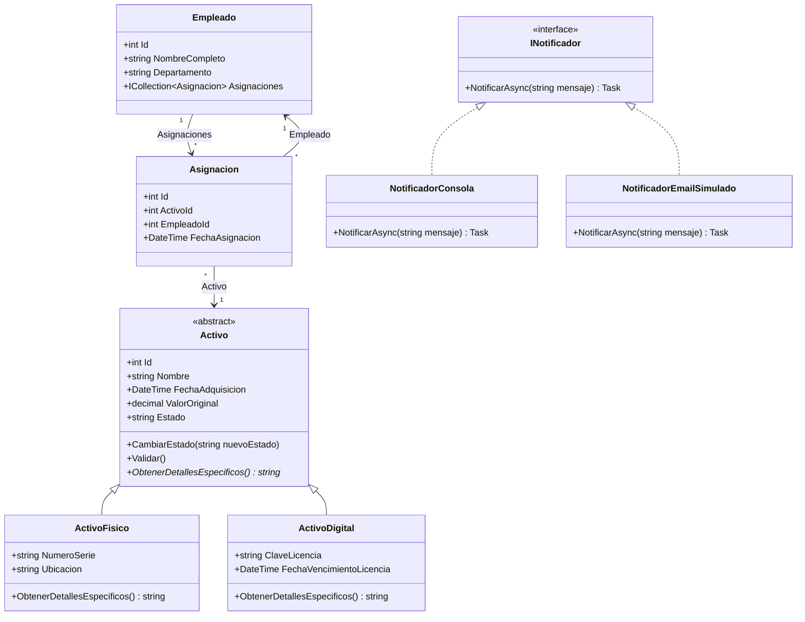

# AssetTracker.API

Sistema de gestión de activos empresariales desarrollado con **ASP.NET Core Web API**, **Entity Framework Core** y **SQLite**, como Trabajo Práctico Integrador de la materia **Programación .NET con C#**.

---

## 1. Problemática elegida

Las organizaciones necesitan llevar un registro centralizado de sus activos: equipos físicos (notebooks, monitores, mobiliario, vehículos) y activos digitales (licencias de software, suscripciones, credenciales).

Sin un sistema dedicado, resulta difícil saber:

- Qué activos existen.
- Cuánto valor económico representan.
- Dónde están ubicados.
- A qué empleados están asignados.
- Cuándo vencen licencias o garantías.
- Qué histórico de asignaciones tuvieron.

**AssetTracker** resuelve esta problemática permitiendo registrar, consultar, actualizar y eliminar activos, manteniendo la información persistida en una base de datos relacional mediante Entity Framework Core.

---

## 2. Descripción breve de la solución

La solución es una **Web API REST** construida con ASP.NET Core que expone endpoints para gestionar activos.

El sistema utiliza:

- **Programación Orientada a Objetos** para modelar el dominio.
- **Herencia** para representar activos físicos y digitales como subtipos de una clase base `Activo`.
- **Polimorfismo** para que cada tipo de activo pueda devolver sus detalles específicos.
- **Interfaces** para desacoplar el mecanismo de notificación del resto del sistema.
- **Entity Framework Core** para persistencia, migraciones y consultas LINQ traducidas a SQL.
- **DTOs** para evitar exponer directamente las entidades y prevenir *overposting*.
- **Validaciones en capas**:
  - Validación de formato y obligatoriedad en el DTO usando DataAnnotations.
  - Validación de reglas de negocio en el dominio mediante el método `Validar()`.
- **Programación asincrónica** para operaciones de acceso a datos con `async`, `await`, `Task`, `ToListAsync()` y `SaveChangesAsync()`.

La API permite crear activos físicos o digitales, consultarlos con filtros y ordenamiento, actualizarlos y eliminarlos.

---

## 3. Clases principales

| Clase | Tipo | Responsabilidad |
| :--- | :--- | :--- |
| `Activo` | Abstracta | Clase base del dominio. Contiene propiedades comunes y comportamiento como `Validar()` y `ObtenerDetallesEspecificos()`. |
| `ActivoFisico` | Concreta | Representa un activo tangible. Agrega `NumeroSerie` y `Ubicacion`. |
| `ActivoDigital` | Concreta | Representa un activo intangible. Agrega `ClaveLicencia` y `FechaVencimientoLicencia`. |
| `Empleado` | Concreta | Representa una persona a la que se le pueden asignar activos. |
| `Asignacion` | Concreta | Representa la relación entre un activo y un empleado en una fecha determinada. |
| `INotificador` | Interfaz | Define el contrato para enviar notificaciones del sistema. |
| `NotificadorConsola` | Concreta | Implementación que escribe notificaciones en consola. |
| `NotificadorEmailSimulado` | Concreta | Implementación que simula el envío de un email. |
| `AssetTrackerContext` | DbContext | Contexto de Entity Framework Core que gestiona entidades, relaciones y persistencia. |
| `CrearActivoDto` | DTO de entrada | Recibe datos desde el cliente para crear o actualizar activos. |
| `ActivoResumenDto` | DTO de salida | Devuelve una versión liviana del activo en listados y reportes. |

### Ejemplo de encapsulamiento

La clase `Activo` posee la propiedad `Estado` con setter privado:

```csharp
public string Estado { get; private set; } = "Disponible";
```

El estado solo puede modificarse a través del método `CambiarEstado(string nuevoEstado)`, que valida que el nuevo estado sea uno de los permitidos:

```csharp
public void CambiarEstado(string nuevoEstado)
{
    if (string.IsNullOrWhiteSpace(nuevoEstado))
        throw new ArgumentException("El estado no puede estar vacío.");

    if (nuevoEstado != "Disponible" && nuevoEstado != "Asignado" && nuevoEstado != "En Mantenimiento")
        throw new ArgumentException("Estado no válido. Debe ser: Disponible, Asignado o En Mantenimiento.");

    Estado = nuevoEstado;
}
```

Esto evita que el objeto quede en un estado inválido.

---

## 4. Relaciones entre ellas

| Relación | Tipo | Explicación |
| :--- | :--- | :--- |
| `Empleado` → `Asignacion` | Uno a muchos | Un empleado puede tener muchas asignaciones a lo largo del tiempo. |
| `Activo` → `Asignacion` | Uno a muchos | Un activo puede ser asignado en distintas fechas. |
| `Asignacion` → `Empleado` | Muchos a uno | Cada asignación referencia a un único empleado. |
| `Asignacion` → `Activo` | Muchos a uno | Cada asignación referencia a un único activo. |
| `Activo` → `ActivoFisico` / `ActivoDigital` | Herencia | Tanto `ActivoFisico` como `ActivoDigital` son tipos de `Activo`. |

### Configuración de integridad referencial

En `AssetTrackerContext`, la relación entre `Asignacion` y `Activo` está configurada con `DeleteBehavior.Restrict`:

```csharp
modelBuilder.Entity<Asignacion>()
    .HasOne(a => a.Activo)
    .WithMany()
    .HasForeignKey(a => a.ActivoId)
    .OnDelete(DeleteBehavior.Restrict);
```

Esto impide eliminar un activo si tiene asignaciones asociadas.

La relación entre `Asignacion` y `Empleado` está configurada con `DeleteBehavior.Cascade`:

```csharp
modelBuilder.Entity<Asignacion>()
    .HasOne(a => a.Empleado)
    .WithMany(e => e.Asignaciones)
    .HasForeignKey(a => a.EmpleadoId)
    .OnDelete(DeleteBehavior.Cascade);
```

Esto significa que, si se elimina un empleado, también se eliminan sus asignaciones asociadas.

---

## 5. Interfaz utilizada

Se implementó la interfaz `INotificador` para representar la capacidad de enviar notificaciones del sistema.

```csharp
public interface INotificador
{
    Task NotificarAsync(string mensaje);
}
```

Implementaciones:

```csharp
public class NotificadorConsola : INotificador
{
    public Task NotificarAsync(string mensaje)
    {
        Console.WriteLine($"[NOTIFICACIÓN CONSOLA] {mensaje}");
        return Task.CompletedTask;
    }
}
```

```csharp
public class NotificadorEmailSimulado : INotificador
{
    public Task NotificarAsync(string mensaje)
    {
        Console.WriteLine($"[EMAIL SIMULADO] Para: admin@assettracker.com | Mensaje: {mensaje}");
        return Task.CompletedTask;
    }
}
```

La implementación se registra en `Program.cs` mediante inyección de dependencias:

```csharp
builder.Services.AddScoped<INotificador, NotificadorConsola>();
```

El controlador recibe la interfaz, no una implementación concreta:

```csharp
public ActivosController(AssetTrackerContext context, INotificador notificador)
{
    _context = context;
    _notificador = notificador;
}
```

### Ventaja

Trabajar contra la interfaz permite:

- Cambiar la implementación sin modificar el controlador.
- Tener múltiples estrategias de notificación.
- Facilitar pruebas unitarias usando mocks o implementaciones simuladas.
- Cumplir con el principio de inversión de dependencias.

Por ejemplo, para cambiar de notificación por consola a email simulado solo se modifica `Program.cs`:

```csharp
builder.Services.AddScoped<INotificador, NotificadorEmailSimulado>();
```

---

## 6. Ejemplo de herencia y polimorfismo

La clase base abstracta `Activo` define un método virtual:

```csharp
public virtual string ObtenerDetallesEspecificos()
{
    return $"Activo: {Nombre} | Valor: {ValorOriginal:C} | Estado: {Estado}";
}
```

Las clases derivadas sobrescriben este método para devolver información específica de cada tipo.

### `ActivoFisico`

```csharp
public override string ObtenerDetallesEspecificos()
{
    return $"[FÍSICO] {Nombre} | Serie: {NumeroSerie} | Ubicación: {Ubicacion} | Valor: {ValorOriginal:C}";
}
```

### `ActivoDigital`

```csharp
public override string ObtenerDetallesEspecificos()
{
    return $"[DIGITAL] {Nombre} | Licencia: {ClaveLicencia} | Vence: {FechaVencimientoLicencia:dd/MM/yyyy} | Valor: {ValorOriginal:C}";
}
```

Esto permite tratar objetos de forma genérica como `Activo`, pero obtener comportamiento específico según el tipo real del objeto en tiempo de ejecución.

La herencia representa una relación lógica del dominio: un activo físico **es un** activo y un activo digital **es un** activo.

---

## 7. Consultas LINQ implementadas

El endpoint `GET /api/activos` acepta parámetros de consulta y combina varias operaciones LINQ:

```csharp
IQueryable<Activo> query = _context.Activos;

// Where: filtra por estado si el cliente envía el parámetro
if (!string.IsNullOrWhiteSpace(estado))
{
    query = query.Where(a => a.Estado == estado);
}

// Sum: agregación sobre el conjunto filtrado
decimal totalValor = await query.SumAsync(a => (decimal?)a.ValorOriginal) ?? 0m;

// OrderBy / OrderByDescending: ordenamiento dinámico
query = criterio switch
{
    "valor" => descendente
        ? query.OrderByDescending(a => a.ValorOriginal)
        : query.OrderBy(a => a.ValorOriginal),

    "fecha" => descendente
        ? query.OrderByDescending(a => a.FechaAdquisicion)
        : query.OrderBy(a => a.FechaAdquisicion),

    _ => descendente
        ? query.OrderByDescending(a => a.Nombre)
        : query.OrderBy(a => a.Nombre)
};

// Select + ToListAsync: proyección a DTO y ejecución
var activos = await query
    .Select(a => new ActivoResumenDto
    {
        Id = a.Id,
        Nombre = a.Nombre,
        FechaAdquisicion = a.FechaAdquisicion,
        ValorOriginal = a.ValorOriginal,
        Estado = a.Estado
    })
    .ToListAsync();
```

### Operaciones utilizadas

| Operación | Función |
| :--- | :--- |
| `Where` | Filtra los activos por estado. |
| `OrderBy` | Ordena de forma ascendente. |
| `OrderByDescending` | Ordena de forma descendente. |
| `Select` | Proyecta la entidad hacia un DTO más liviano. |
| `SumAsync` | Calcula el valor total de los activos filtrados. |
| `ToListAsync` | Ejecuta la consulta y convierte el resultado a lista. |

### Explicación de ejecución

Mientras se usan `Where`, `OrderBy`, `Select` y `Sum`, la consulta sigue siendo `IQueryable`. EF Core traduce esas operaciones a SQL.

La consulta se ejecuta realmente cuando se llama a métodos como:

```csharp
await query.SumAsync(...);
```

o

```csharp
await query.ToListAsync();
```

En ese momento EF Core envía el SQL correspondiente a la base de datos y materializa los resultados.

---

## 8. Instrucciones para ejecutar el proyecto

### Requisitos

- .NET SDK 10.0 o superior.
- Herramienta de línea de comandos de Entity Framework Core.

### Instalación de la herramienta de EF Core

Si todavía no la tenés instalada:

```bash
dotnet tool install --global dotnet-ef
```

### Clonar el repositorio

```bash
git clone https://github.com/santiagojsomma-work/AssetTracker.API.git
```

### Ingresar a la carpeta del proyecto

```bash
cd AssetTracker.API/AssetTracker.API
```

### Restaurar paquetes

```bash
dotnet restore
```

### Crear la base de datos con migraciones

```bash
dotnet ef database update
```

Este comando genera la base de datos SQLite a partir de las migraciones existentes.

El archivo de base de datos, por ejemplo `assettracker.db`, se genera localmente y no debe subirse al repositorio.

### Ejecutar la aplicación

```bash
dotnet run
```

### Abrir Swagger

Una vez iniciada la aplicación, abrir en el navegador la URL de Swagger indicada en la consola, por ejemplo:

```bash
https://localhost:7001/swagger
```

La ruta exacta puede variar según la configuración local.

---

## Endpoints disponibles

| Método | Ruta | Descripción |
| :--- | :--- | :--- |
| `GET` | `/api/activos` | Lista activos. Acepta filtros y ordenamiento. |
| `GET` | `/api/activos/{id}` | Obtiene un activo por ID. |
| `POST` | `/api/activos` | Crea un activo físico o digital. |
| `PUT` | `/api/activos/{id}` | Actualiza un activo existente. |
| `DELETE` | `/api/activos/{id}` | Elimina un activo. |

---

## Ejemplos de uso

### Crear un activo físico

`POST /api/activos`

```json
{
  "nombre": "Notebook Lenovo ThinkPad",
  "fechaAdquisicion": "2024-05-10",
  "valorOriginal": 850000,
  "tipoActivo": "fisico",
  "numeroSerie": "SN-LENOVO-001",
  "ubicacion": "Oficina 3"
}
```

### Crear un activo digital

`POST /api/activos`

```json
{
  "nombre": "Licencia Microsoft 365",
  "fechaAdquisicion": "2025-01-15",
  "valorOriginal": 120000,
  "tipoActivo": "digital",
  "claveLicencia": "XXXXX-YYYYY-ZZZZZ",
  "fechaVencimientoLicencia": "2026-12-31"
}
```

### Listar activos

`GET /api/activos`

### Listar activos disponibles

`GET /api/activos?estado=Disponible`

### Ordenar por valor descendente

`GET /api/activos?ordenarPor=valor&descendente=true`

### Ordenar por fecha ascendente

`GET /api/activos?ordenarPor=fecha&descendente=false`

### Actualizar un activo

`PUT /api/activos/1`

```json
{
  "nombre": "Notebook Lenovo ThinkPad Actualizada",
  "fechaAdquisicion": "2024-05-10",
  "valorOriginal": 900000,
  "tipoActivo": "fisico",
  "numeroSerie": "SN-LENOVO-001-ACT",
  "ubicacion": "Oficina 8"
}
```

### Eliminar un activo

`DELETE /api/activos/1`

---

## Demostración de persistencia

Para demostrar que los datos persisten entre ejecuciones:

1. Ejecutar la aplicación:

```bash
dotnet run
```

2. Crear uno o más activos mediante `POST /api/activos`.

3. Detener la aplicación.

4. Volver a ejecutar la aplicación:

```bash
dotnet run
```

5. Consultar `GET /api/activos`.

Los activos creados anteriormente deben seguir apareciendo.

---

## Diagrama de clases



---

## Estructura del proyecto

```text
AssetTracker.API/
├── Controllers/
│   └── ActivosController.cs
├── Data/
│   └── AssetTrackerContext.cs
├── Dto/
│   ├── CrearActivoDto.cs
│   └── ActivoResumenDto.cs
├── Migrations/
├── Models/
│   ├── Activo.cs
│   ├── ActivoFisico.cs
│   ├── ActivoDigital.cs
│   ├── Empleado.cs
│   └── Asignacion.cs
├── Services/
│   ├── INotificador.cs
│   ├── NotificadorConsola.cs
│   └── NotificadorEmailSimulado.cs
├── appsettings.json
└── Program.cs
```

---

## Resumen de requisitos cubiertos

| Requisito | Implementación |
| :--- | :--- |
| Modelado de dominio | Clases `Activo`, `ActivoFisico`, `ActivoDigital`, `Empleado`, `Asignacion`. |
| Relaciones | Uno a muchos entre `Empleado` y `Asignacion`, y entre `Activo` y `Asignacion`. |
| Herencia | `Activo` como clase base; `ActivoFisico` y `ActivoDigital` como derivadas. |
| Polimorfismo | Método virtual `ObtenerDetallesEspecificos()` sobrescrito. |
| Interfaz | `INotificador` con `NotificadorConsola` y `NotificadorEmailSimulado`. |
| LINQ | `Where`, `OrderBy`, `OrderByDescending`, `Select`, `SumAsync`, `ToListAsync`. |
| Persistencia | Entity Framework Core con `DbContext`, `DbSet<T>`, migraciones y SQLite. |
| CRUD | Endpoints `GET`, `POST`, `PUT` y `DELETE` en `ActivosController`. |
| Asincronía | Uso de `async`, `await`, `Task`, `ToListAsync()` y `SaveChangesAsync()`. |
| Validaciones | DataAnnotations en DTO y validaciones de dominio en `Activo.Validar()`. |